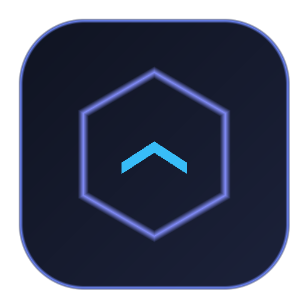

<div align="center">



<h1>AiderStudio</h1>

<p><strong>IDE desktop de pair-programming IA pilotant Aider CLI avec Ollama en local et fournisseurs cloud externes.</strong></p>

<p>
  <a href="https://github.com/superfeedboy/AiderStudio/actions/workflows/build.yml"></a>
  <a href="https://github.com/superfeedboy/AiderStudio/releases"></a>
  <a href="https://github.com/superfeedboy/AiderStudio/releases"></a>
</p>
<p>
  <a href="https://v2.tauri.app/"></a>
  <a href="https://vuejs.org/"></a>
  <a href="https://www.rust-lang.org/"></a>
  <a href="https://aider.chat/"></a>
  <a href="https://ollama.com/"></a>
</p>

</div>

---

## Présentation

**AiderStudio** est une application desktop native (**macOS Universal** et **Windows x64**) conçue pour le pair-programming assisté par IA. Elle associe la puissance d'édition de code de **[Aider](https://aider.chat/)** à une interface moderne en 3 volets, une orchestration multi-agents et un fonctionnement hybride combinant des modèles locaux via **[Ollama](https://ollama.com/)** et des fournisseurs cloud externes (**Gemini**, **OpenAI**, **Anthropic**, **DeepSeek**, **OpenRouter**, **Mistral**).

L'application est optimisée pour tirer le meilleur parti des modèles locaux à fenêtre de contexte contrainte (8K–16K) tout en permettant de déléguer certains rôles spécialisés à des modèles cloud lorsque c'est nécessaire.

## Fonctionnalités

- **Orchestration multi-agents configurable** : pipeline collaboratif jusqu'à **7 rôles spécialisés** (*Architecte & Orchestrateur*, *Cartographe 0-tok*, *Designer UI/UX*, *Codeur*, *Refactoring*, *Testeur*, *Synthétiseur*), chacun routable indépendamment vers Ollama ou un fournisseur API externe, avec trace d'exécution détaillée par étape.
- **Pilotage adaptatif d'Aider CLI** : stratégie automatique du format d'édition (`Auto (8K)` : mode `whole` pour les fichiers ≤ 250 lignes sur Ollama / ≤ 120 lignes sur cloud, bascule en `diff` au-delà), génération automatique de `.aiderignore` pour protéger la fenêtre de contexte, initialisation Git automatique et transmission dynamique de `num_ctx`.
- **Mode hybride Local (Ollama) & Fournisseurs Cloud** : diagnostic temps réel et démarrage automatique d'Ollama, gestion et validation de clés API avec découverte automatique des modèles pour **Gemini**, **OpenAI**, **Anthropic (Claude)**, **DeepSeek**, **OpenRouter** et **Mistral**.
- **Espace de travail en 3 panneaux & mode écran large** : `Le Menu` (arborescence multi-projets, dossiers partagés, multi-conversations avec auto-titrage et renommage), `La Discussion` (coloration syntaxique Highlight.js, mentions `@file`, `@tool`, `@plugin`, `@mcp`, pièces jointes fichiers & images, flux temps réel et annulation de prompt) et `Le Code` (tiroir redimensionnable passant en split 50/50 sur grand écran).
- **Revue Git Diff, Undo granulaire & Artefacts** : inspection des fichiers modifiés (lignes ajoutées, modifiées, supprimées), annulation ciblée par fichier ou restauration globale (`Tout défaire`), et prévisualisation intégrée des artefacts générés (code, HTML, SVG).
- **HUD temps réel (Télémétrie, Contexte & Quotas)** : suivi matériel natif (CPU, GPU, RAM, température sur macOS et Windows), barre de contexte horizontale stackée par sous-agent avec alertes et compactage `/compact` (seuils 70 % / 80 % / 95 %), et suivi journalier de la consommation de tokens API externes par fournisseur.
- **Gestion avancée des contextes & mémoire** : séparation entre le contexte global permanent du projet et l'objectif/mémoire dédié à chaque conversation, éditables et réinitialisables à la volée.
- **Intégration MCP (Model Context Protocol)** : ajout et test de serveurs MCP `stdio` (préconfigurations SQLite et PostgreSQL ou serveurs personnalisés) pour exposer des bases de données et outils locaux aux agents.
- **Thèmes & distribution desktop** : thèmes *Système*, *Sombre* et *Clair* ; builds automatisés via GitHub Actions pour **macOS Universal (`.dmg`)** et **Windows x64 (`.msi` / `.exe`)**.

## Stack technique & Prérequis

### Architecture de l'application

| Couche | Technologies |
| :--- | :--- |
| **Frontend** | [Vue 3](https://vuejs.org/) (`3.5`) · [TypeScript](https://www.typescriptlang.org/) (`5.9`) · [Pinia](https://pinia.vuejs.org/) (`2.3`) · [Vite](https://vite.dev/) (`6.4`) · [Highlight.js](https://highlightjs.org/) (`11.12`) |
| **Backend Desktop** | [Tauri v2](https://v2.tauri.app/) (`2.12`) · [Rust](https://www.rust-lang.org/) (édition 2021, `tokio`, `reqwest`, `serde`) |
| **CI/CD & Packaging** | Node.js `22+` · Toolchain Rust stable · GitHub Actions (`.dmg`, `.msi`, `.exe`) |

### Dépendances runtime indispensables

Pour exécuter **AiderStudio** en local, les outils suivants doivent être installés sur la machine :

- **[Git](https://git-scm.com/)** : indispensable pour le suivi des diffs et les fonctions d'annulation (`Undo`).
- **[Aider CLI](https://aider.chat/)** — [Documentation d'installation](https://aider.chat/docs/install.html) · [Dépôt GitHub](https://github.com/Aider-AI/aider) : moteur pair-programming piloté par AiderStudio (requiert Python 3.8–3.13).

  ```bash
  # Méthode recommandée via pipx
  pipx install aider-chat

  # Ou via l'installeur officiel Python
  python -m pip install aider-install
  aider-install
  ```

  <details>
  <summary>Installeurs rapides (macOS / Linux / Windows PowerShell)</summary>

  ```bash
  # macOS / Linux
  curl -LsSf https://aider.chat/install.sh | sh
  ```

  ```powershell
  # Windows (PowerShell)
  powershell -ExecutionPolicy ByPass -c "irm https://aider.chat/install.ps1 | iex"
  ```

  </details>

  Vérifiez l'installation dans votre terminal :

  ```bash
  aider --version
  ```

- **[Ollama](https://ollama.com/)** — [Téléchargement](https://ollama.com/download) · [Modèle Qwen2.5-Coder](https://ollama.com/library/qwen2.5-coder) · [Dépôt GitHub](https://github.com/ollama/ollama) : moteur d'inférence LLM local utilisé par défaut et comme repli.

### Compiler l'application depuis les sources

```bash
npm install
npx tauri dev    # Mode développement
npx tauri build  # Build du binaire et des installeurs (.dmg / .msi / .exe)
```

## Paramétrage et build de Qwen2.5-Coder 7B (`q5_K_M`) dans Ollama

Le modèle local recommandé pour AiderStudio est **`qwen2.5-coder:7b-instruct-q5_K_M`** (~7,6B paramètres, quantification 5-bit `Q5_K_M`, ~5,4 Go).

> **Note sur le nom du tag Ollama :** dans le registre officiel Ollama, la quantification `Q5_K_M` utilise un tiret (`qwen2.5-coder:7b-instruct-q5_K_M`) et non un second `:` (`:5q_K_M`). Utilisez bien `qwen2.5-coder:7b-instruct-q5_K_M` dans vos commandes `ollama pull` et votre `Modelfile`.

### 1. Optimiser les variables d'environnement Ollama (Flash Attention & KV Cache)

Comme documenté dans les paramètres d'AiderStudio, activer **Flash Attention** et la **quantification `q8_0` du KV Cache** permet de faire tenir une fenêtre de contexte **16K (`16384` tokens) à 100 % en VRAM** sur un GPU de 8 Go (ex. NVIDIA RTX 4060 Ti 8 Go) avec la version `q5_K_M` :

- **macOS (zsh / bash)** — définir les variables pour l'application GUI Ollama puis redémarrer Ollama :

  ```bash
  launchctl setenv OLLAMA_FLASH_ATTENTION 1
  launchctl setenv OLLAMA_KV_CACHE_TYPE q8_0
  launchctl setenv OLLAMA_KEEP_ALIVE 15m
  ```

- **Windows (PowerShell)** — persister les variables utilisateur puis redémarrer Ollama depuis la zone de notification :

  ```powershell
  setx OLLAMA_FLASH_ATTENTION "1"
  setx OLLAMA_KV_CACHE_TYPE "q8_0"
  setx OLLAMA_KEEP_ALIVE "15m"
  ```

### 2. Télécharger le modèle de base

```bash
ollama pull qwen2.5-coder:7b-instruct-q5_K_M
```

### 3. Créer le `Modelfile` dédié

Créez un fichier nommé `Modelfile` dans un dossier de travail :

```dockerfile
# Modèle de base Qwen2.5-Coder 7B Instruct quantifié en Q5_K_M
FROM qwen2.5-coder:7b-instruct-q5_K_M

# Alternative depuis un fichier GGUF local :
# FROM ./qwen2.5-coder-7b-instruct-q5_k_m.gguf

# Fenêtre de contexte cible :
# - 8192  : GPU 8 Go standard (sans KV cache q8_0)
# - 16384 : GPU 8 Go avec OLLAMA_FLASH_ATTENTION=1 + OLLAMA_KV_CACHE_TYPE=q8_0
# - 32768 : GPU 12–16+ Go de VRAM ou Mac Apple Silicon >= 16 Go
PARAMETER num_ctx 16384

# Température basse pour une génération déterministe et des diffs fiables
PARAMETER temperature 0.15
PARAMETER top_p 0.9
PARAMETER repeat_penalty 1.05
```

### 4. Builder le modèle personnalisé dans Ollama

Depuis le répertoire contenant votre `Modelfile`, compilez l'image du modèle :

```bash
ollama create qwen2.5-coder-7b-aider -f Modelfile
```

### 5. Vérifier le build et l'exécution GPU

```bash
# Lister les modèles installés et inspecter les paramètres compilés
ollama list
ollama show qwen2.5-coder-7b-aider

# Tester l'inférence
ollama run qwen2.5-coder-7b-aider "Bonjour, confirme que tu es prêt."
```

Dans un second terminal (pendant ou juste après l'exécution), vérifiez la répartition mémoire et la taille de contexte active :

```bash
ollama ps
```

Assurez-vous que la colonne **`PROCESSOR`** affiche **`100% GPU`** (sans débordement CPU) et que **`CONTEXT`** correspond bien à **`16384`** (ou **`8192`** selon votre profil).

### 6. Configurer le modèle dans AiderStudio (`Paramètres → Général`)

Renseignez les champs suivants dans **Paramètres → Général** d'AiderStudio :

- **URL API Ollama** : `http://127.0.0.1:11434`
- **Modèle Ollama par défaut (local / repli)** : `qwen2.5-coder-7b-aider` (vous pouvez aussi sélectionner directement `qwen2.5-coder:7b-instruct-q5_K_M`, AiderStudio transmettant automatiquement `num_ctx` à Aider via `aider_model_settings.yml`)
- **Fenêtre de contexte cible Ollama (tokens)** : `16384` (`16K`) ou `8192` (`8K`), alignée sur la valeur `num_ctx` du `Modelfile`
- **Format d'édition Aider** : `Auto (8K)`
- **Binaire Aider CLI** : `aider` (ou le chemin complet vers votre exécutable) et cochez **Démarrer Ollama automatiquement si arrêté**
